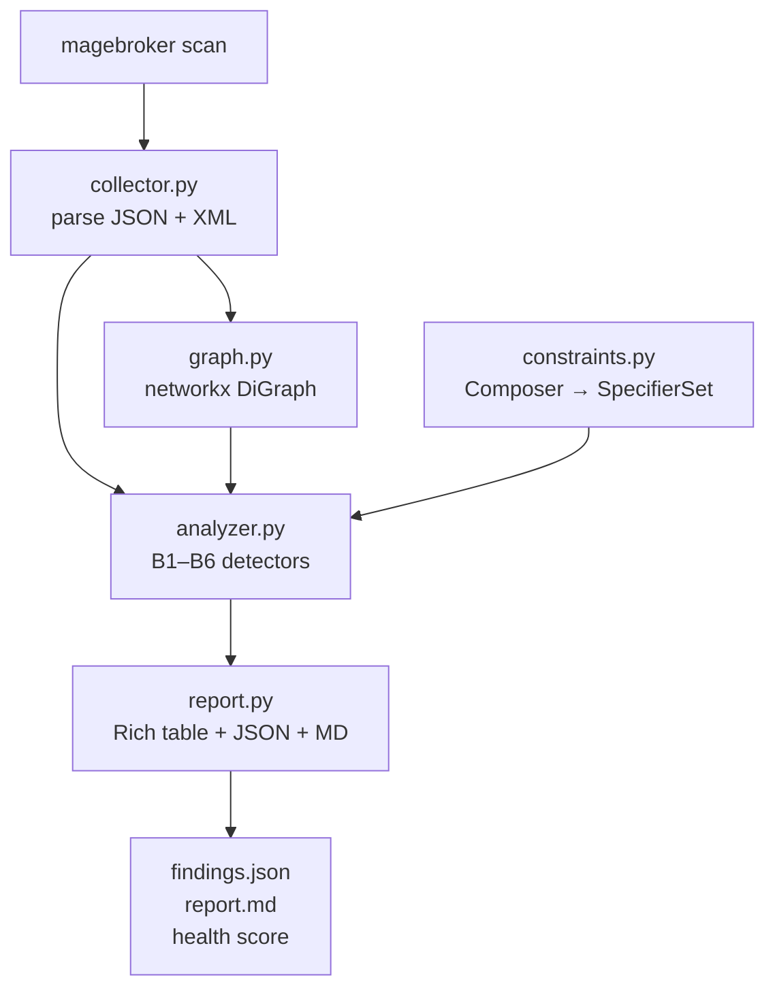

# MageBroker

> **Offline Magento 2 dependency broker** — scan your extension stack, find every upgrade blocker,
> and generate an AI-assisted fix plan without touching the internet.

---

## The Problem: Magento Upgrade Dependency Hell

Upgrading a Magento 2 store from one minor version to another (e.g. 2.4.6 → 2.4.7) requires
coordinating dozens of third-party and custom modules that each carry their own `composer.json`
constraints, load-order sequences, and dependency injection preferences.  The issues are silent:

- A module's `^102.0` constraint **conflicts** with the locked `103.0.6` framework.
- A missing package is absent from `composer.lock` but nothing warns you until the runtime explodes.
- Two modules both declare a DI `<preference>` for the same interface — the last one loaded wins,
  unpredictably.
- Load-sequence cycles cause a white screen. Ghost sequence references cause silent boot failures.
- A `~8.1.0` PHP constraint blocks the entire upgrade to a PHP 8.2/8.3-only Magento version.

Traditional approaches involve manually grepping dozens of XML and JSON files.  MageBroker
automates that in under a second.

---

## Solution

MageBroker is a fully-offline CLI tool built in Python.  It:

1. **Parses** the project's `composer.json`, `composer.lock`, all module `etc/module.xml` and
   `etc/di.xml` files into typed data structures.
2. **Builds** a directed graph of module relationships with `networkx`.
3. **Runs** six targeted detectors (B1–B6) that surface every known class of upgrade problem.
4. **Outputs** a `findings.json`, a `report.md` table, a health score (0–100), and a Rich terminal
   table.
5. **Drives** an IBM Bob custom mode that spawns parallel subagents per finding type, merges their
   analysis into `fix-plan.md`, applies safe fixes automatically, and re-scans to verify.

---

## Architecture



---

## Install

```bash
# requires Python 3.10+
python -m venv .venv
source .venv/bin/activate
pip install -e .
```

---

## Usage

```bash
# Scan sample-magento/ targeting Magento 2.4.7
magebroker scan sample-magento --target 2.4.7

# Output artefacts are written to the project root:
#   findings.json   machine-readable findings list
#   report.md       Markdown table + health score
```

### Example terminal output

```
              MageBroker Findings
┌──────────┬────┬────────────────┬─────────────────────────────────────────────────────┐
│ Severity │ ID │ Module         │ Message                                             │
├──────────┼────┼────────────────┼─────────────────────────────────────────────────────┤
│ critical │ B1 │ Acme_Checkout  │ requires magento/framework '^102.0' but lock has    │
│          │    │                │ 103.0.6                                             │
│ critical │ B2 │ Acme_Payment   │ requires acme/payment-gateway '^1.0' not in lock   │
│ critical │ B3 │ Acme_Checkout  │ Circular sequence: Acme_Checkout -> Acme_Catalog   │
│ warning  │ B4 │ Acme_Catalog,  │ Duplicate preference for ProductRepositoryInterface │
│          │    │ Acme_Customer  │ in 2 modules                                        │
│ critical │ B5 │ Acme_Inventory │ php '~8.1.0' incompatible with 2.4.7 (needs 8.2+) │
│ warning  │ B6 │ Acme_Search    │ sequences 'Acme_Analytics' which does not exist    │
└──────────┴────┴────────────────┴─────────────────────────────────────────────────────┘
Health score: 25 / 100
```

---

## Bug Catalogue

| ID | Type | Severity | Module | Description |
|----|------|----------|--------|-------------|
| B1 | version_conflict | critical | Acme_Checkout | `^102.0` constraint conflicts with `magento/framework 103.0.6` in lock |
| B2 | missing_dep | critical | Acme_Payment | `acme/payment-gateway ^1.0` absent from `composer.lock` |
| B3 | circular_sequence | critical | Acme_Checkout | Acme_Checkout ↔ Acme_Catalog circular load sequence |
| B4 | duplicate_preference | warning | Acme_Catalog + Acme_Customer | Both declare DI preference for `ProductRepositoryInterface` |
| B5 | upgrade_blocker | critical | Acme_Inventory | `~8.1.0` PHP constraint blocks Magento 2.4.7 (needs PHP 8.2/8.3) |
| B6 | ghost_sequence | warning | Acme_Search | Sequences `Acme_Analytics` which does not exist |

---

## Magento Broker — IBM Bob Custom Mode

The **Magento Broker** mode is a project-scoped Bob mode (`.bob/custom_modes.yaml`) that drives
the full analyse → plan → fix → verify cycle automatically.

### How to select and run it

1. Open the **mode picker** in the Bob UI (bottom-left of the chat window, or use the `/mode`
   command in the input bar).
2. Choose **Magento Broker** from the list.
3. Type any message — e.g. `Run the full broker cycle.`
4. Bob will execute the six-step workflow:
   - **Step 1** Scan `sample-magento/` and read `findings.json`
   - **Step 2** Spawn three parallel subagents (composer / sequence / di)
   - **Step 3** Merge results into `fix-plan.md`
   - **Step 4** Apply all "auto" fixes to source files
   - **Step 5** Re-scan to verify
   - **Step 6** Print a before/after summary

> **Do NOT run `composer install` or any network command.**  
> B2 (missing_dep) is intentionally unfixable offline; the mode writes the `composer require`
> command into `fix-plan.md` and marks it **manual**.

### Reset the demo

```bash
bash scripts/reset-demo.sh
```

This restores `sample-magento/` from git and deletes `findings.json`, `report.md`, and
`fix-plan.md` so the cycle can be re-run from scratch.

---

## Before / After Results

| Metric | Before | After (auto fixes) |
|--------|--------|--------------------|
| Total findings | 6 | 1 |
| Critical | 4 | 1 (B2 — manual) |
| Warning | 2 | 0 |
| Health score | 25 / 100 | 80 / 100 |
| Fixed automatically | — | B1, B3, B4, B5, B6 |
| Remains manual | — | B2 (`composer require acme/payment-gateway`) |

---

## How IBM Bob Was Used

This project was built entirely with IBM Bob across three phases.  The table below shows which Bob
capability was used for each task.

| Task | Bob capability |
|------|---------------|
| Decompose a vague "Magento upgrade tooling" idea into a concrete 3-phase plan with file tree and bug catalogue | **Plan mode** |
| Scaffold `sample-magento/` with deliberate bugs planted in exact files | **Agent mode** |
| Implement `constraints.py`, `collector.py`, `graph.py`, `analyzer.py`, `report.py`, `cli.py` | **Agent mode** |
| Write the full `pytest` suite (B1–B6 + clean fixture + zero-findings assertion) | **Agent mode** |
| Debug the `op.replace("=","==")` turns `>=` into `>==` bug | **Agent mode** |
| Add AND-range parsing, Magento patch-version normalisation, `^0.x` semantics, and unknown-syntax error | **Agent mode** |
| Refactor B4 from one-row-per-module to one-row-per-interface | **Agent mode** |
| Author `.bob/custom_modes.yaml` using the `create-mode` skill | **Agent mode + skill** |
| Drive the analyse → plan → fix → verify cycle on a live project | **Magento Broker custom mode + parallel subagents** |

---

## bob_sessions/

The `bob_sessions/` directory contains session notes from the Bob-assisted build process.

| File | Contents |
|------|----------|
| `phase2-scanner.md` | Phase 2 session notes: scanner implementation decisions and corrections |

---

## Development

```bash
# Run tests
.venv/bin/pytest tests/ -q

# Run a scan manually
.venv/bin/magebroker scan sample-magento --target 2.4.7

# Reset demo state
bash scripts/reset-demo.sh
```
