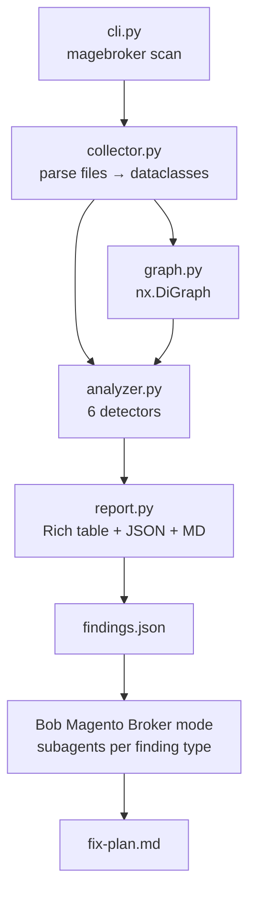

# Project: "MageBroker" (IBM Bob 2.0 hackathon). A Magento 2 dependency broker that turns hours of
composer trial-and-error during upgrades/extension installs into one scan + an AI-generated fix plan.

Stack: Python 3.10+, Typer, Rich, networkx, packaging. Fully offline, no network calls.

1. sample-magento/ : minimal fake Magento 2.4.6 project (root composer.json + composer.lock,
   app/code/Acme/<6 modules>/ each with composer.json, registration.php, etc/module.xml, etc/di.xml).
   Plant exactly these bugs and document them in sample-magento/BUGS.md:
   B1 version conflict: two modules require incompatible magento/framework ranges
   B2 missing dependency: a module requires a package not in composer.lock
   B3 circular <sequence> between two modules in module.xml
   B4 duplicate di.xml <preference> for the same interface in two modules
   B5 upgrade blocker: a module requiring php "~8.1.0" (Magento 2.4.7 needs PHP 8.2/8.3)
   B6 module declared in module.xml sequence but not present in the project

2. data/compat.json : small local matrix (2.4.6 and 2.4.7 → supported PHP versions, magento/framework version).

3. magebroker/ package:
   - collector.py : parse composer.json, composer.lock, module.xml, di.xml into dataclasses
   - graph.py     : networkx graph of modules, packages and sequence edges
   - analyzer.py  : one detector per bug type; each finding = {id, type, severity, module, file, message, evidence}
   - report.py    : Rich table + findings.json + report.md, health score 0-100
   - cli.py       : `magebroker scan <path> [--target 2.4.7]`, exit code 1 if critical findings (CI gate)
   - tests/       : pytest proving each of B1-B6 is detected

4. Bob custom mode "Magento Broker": check Bob's documentation for the correct custom-mode file format and
   location. The mode reads findings.json, uses one subagent per finding type in parallel, writes fix-plan.md
   (ordered composer commands + file edits), applies safe fixes, then re-runs the scan to prove issues dropped.

Output: a concise plan split into 3 implementation phases (Phase 1: sample project + data,
Phase 2: scanner + tests, Phase 3: custom mode + README), plus the full file tree.
Do not write code yet. Keep the plan short.

---

**Status:** active  **Date:** 2026-09-27

---

### 👤 User

Project: "MageBroker" (IBM Bob 2.0 hackathon). A Magento 2 dependency broker that turns hours of
composer trial-and-error during upgrades/extension installs into one scan + an AI-generated fix plan.

Stack: Python 3.10+, Typer, Rich, networkx, packaging. Fully offline, no network calls.

1. sample-magento/ : minimal fake Magento 2.4.6 project (root composer.json + composer.lock,
   app/code/Acme/<6 modules>/ each with composer.json, registration.php, etc/module.xml, etc/di.xml).
   Plant exactly these bugs and document them in sample-magento/BUGS.md:
   B1 version conflict: two modules require incompatible magento/framework ranges
   B2 missing dependency: a module requires a package not in composer.lock
   B3 circular <sequence> between two modules in module.xml
   B4 duplicate di.xml <preference> for the same interface in two modules
   B5 upgrade blocker: a module requiring php "~8.1.0" (Magento 2.4.7 needs PHP 8.2/8.3)
   B6 module declared in module.xml sequence but not present in the project

2. data/compat.json : small local matrix (2.4.6 and 2.4.7 → supported PHP versions, magento/framework version).

3. magebroker/ package:
   - collector.py : parse composer.json, composer.lock, module.xml, di.xml into dataclasses
   - graph.py     : networkx graph of modules, packages and sequence edges
   - analyzer.py  : one detector per bug type; each finding = {id, type, severity, module, file, message, evidence}
   - report.py    : Rich table + findings.json + report.md, health score 0-100
   - cli.py       : `magebroker scan <path> [--target 2.4.7]`, exit code 1 if critical findings (CI gate)
   - tests/       : pytest proving each of B1-B6 is detected

4. Bob custom mode "Magento Broker": check Bob's documentation for the correct custom-mode file format and
   location. The mode reads findings.json, uses one subagent per finding type in parallel, writes fix-plan.md
   (ordered composer commands + file edits), applies safe fixes, then re-runs the scan to prove issues dropped.

Output: a concise plan split into 3 implementation phases (Phase 1: sample project + data,
Phase 2: scanner + tests, Phase 3: custom mode + README), plus the full file tree.
Do not write code yet. Keep the plan short.

---

### 🤖 Assistant

> 🔧 called: use_skill


> 🔧 **use_skill** — create-plan

### 🤖 Assistant

> 🔧 called: spawn_subagent

The requirements are clearly scoped in the message — no ambiguous intent. Let me research the existing workspace structure before writing the plan.

> 🔧 **spawn_subagent** — explore

### 🤖 Assistant

> 🔧 called: search_ibm_docs

Now let me check Bob's documentation for the custom mode file format and location before writing the plan.

> 🔧 **search_ibm_docs** — bob

### 🤖 Assistant

> 🔧 called: search_ibm_docs


> 🔧 **search_ibm_docs** — bob

### 🤖 Assistant

> 🔧 called: write_file

Now I have everything needed. Let me write the plan file.

> 🔧 **write_file** — magebroker-plan.md

### 🤖 Assistant

Here is the full plan. The workspace is a clean git repo with nothing in it yet.

---

## Architecture at a Glance



---

## Plan: [`magebroker-plan.md`](magebroker-plan.md)

---

### Phase 1 — Sample Project + Data
Create `sample-magento/` with 6 Acme modules, root `composer.json`/`lock`, and `data/compat.json`. Every one of the 6 bugs is physically embedded in real files. `BUGS.md` cross-references each bug to its exact file.

| Bug | Type | Planted in |
|-----|------|-----------|
| B1 | Version conflict | `Acme_Catalog` vs `Acme_Checkout` composer.json — incompatible `magento/framework` ranges |
| B2 | Missing dep | `Acme_Payment` requires `acme/payment-gateway` absent from composer.lock |
| B3 | Circular sequence | `Acme_Catalog` ↔ `Acme_Checkout` module.xml sequence loop |
| B4 | Duplicate DI preference | Same interface preferred in `Acme_Catalog` and `Acme_Customer` di.xml |
| B5 | Upgrade blocker | `Acme_Inventory` pins `php ~8.1.0`; 2.4.7 needs 8.2/8.3 |
| B6 | Ghost sequence | `Acme_Search` sequences `Acme_Analytics` which doesn't exist |

---

### Phase 2 — Scanner Package + Tests
Seven sub-tasks: `collector.py` → `graph.py` → `analyzer.py` (6 detectors) → `report.py` → `cli.py` → `pyproject.toml` → `tests/`.

---

### Phase 3 — Bob Custom Mode + README
`.bob/custom_modes.yaml` with slug `magento-broker`, groups `read + edit + execute + subagent + skill`. Role definition instructs the mode to spawn one subagent per finding type, merge into `fix-plan.md`, apply safe fixes, re-run scan to verify.

---

### Key Decisions Baked In

- **`packaging` library** handles semver specifier intersection for B1 and B5 — no custom range math.
- **`networkx.find_cycle()`** detects B3 on the sequence-only subgraph.
- **`data/compat.json`** loaded at CLI runtime via `__file__`-relative path — simple and zero-dependency.
- **Bob mode is project-scoped** (`.bob/custom_modes.yaml`) so it travels with the repo.
- **Exit code 1** on any `critical` finding — usable as a CI gate.

---

A few things to confirm before implementation:

1. **6 modules** — the request says "6 modules". The plan assigns one bug per module (Catalog, Checkout, Customer, Payment, Inventory, Search). B1 spans Catalog+Checkout, B3 spans Catalog+Checkout — two bugs share two modules. Is this fine, or should each module carry exactly one unique bug?
2. **Health score deductions** — plan proposes −20 per `critical`, −5 per `warning` (floor 0). Any preference on the weighting?
3. **Safe auto-fixes in the Bob mode** — plan limits auto-apply to non-destructive edits (version constraint widening, adding a missing sequence entry, removing a duplicate preference). Composer commands go into `fix-plan.md` but are NOT auto-run. Correct?

---

### 👤 User

Answers:
1. Shared modules are fine (realistic: Catalog and Checkout are tightly coupled). Keep 6 modules.
2. Health score: -20 per critical, -5 per warning, floor 0. OK.
3. Correct: composer commands go into fix-plan.md only, never auto-run. Safe auto-fixes are:
   B1 align the constraint with the locked version, B3 remove one direction of the circular sequence,
   B4 remove the duplicate preference, B5 widen php to "~8.2.0||~8.3.0", B6 REMOVE the ghost sequence
   (not add). B2 cannot be fixed offline -> mark it "manual" in fix-plan.md with the composer require
   command. Expected re-scan: 5 fixed, 1 manual.

Corrections (update magebroker-plan.md with these):
a. packaging cannot parse Composer syntax. Add magebroker/constraints.py that converts Composer
   constraints (^, ~, *, ||, >=, exact) into packaging SpecifierSets. B1/B5 must use it.
b. composer.lock must include every magento/module-* package the sample modules use (except the
   deliberate B2 package). Map "magento/module-catalog" <-> "Magento_Catalog" so core modules are
   never flagged as ghost or missing.
c. compat.json: 2.4.6 -> magento/framework 103.0.6, PHP 8.1/8.2; 2.4.7 -> 103.0.7, PHP 8.2/8.3.
   Lock magento/framework at 103.0.6.
d. Phase 2 tests: add tests/fixtures/clean-magento/ (no bugs) and a test asserting zero findings
   and exit code 0.
e. Put the architecture mermaid diagram in the README later.

Now implement Phase 1 only. When done, run:
git add -A && git commit -m "Phase 1: sample Magento project (built with Bob)"
Then stop and show me the file tree and BUGS.md.

---

### 🤖 Assistant

> 🔧 called: update_todo_list


> 🔧 **update_todo_list** — 
[-] Update magebroker-plan.md with corrections a-e
[ ] Create data/compat.json
[ ] Create sample-magento/composer.json (root)
[ ] Create sample-magento/composer.lock (with magento/* packages, lock framework at 103.0.6, omit acme/payment-gateway)
[ ] Create Acme_Catalog module (B1 ^103.0, B3 circular sequence, B4 duplicate preference)
[ ] Create Acme_Checkout module (B1 ^102.0, B3 circular sequence)
[ ] Create Acme_Customer module (B4 duplicate preference)
[ ] Create Acme_Payment module (B2 missing dep)
[ ] Create Acme_Inventory module (B5 PHP ~8.1.0)
[ ] Create Acme_Search module (B6 ghost sequence)
[ ] Write sample-magento/BUGS.md
[ ] git add -A && git commit


### 🤖 Assistant

> 🔧 called: read_file


> 🔧 **read_file** — magebroker-plan.md

### 🤖 Assistant

> 🔧 called: apply_diff

Now I'll update the plan with all 5 corrections and then implement Phase 1 in parallel.

> 🔧 **apply_diff** — magebroker-plan.md

### 🤖 Assistant

> 🔧 called: update_todo_list

Plan updated. Now implementing Phase 1 — all files can be created in parallel.

> 🔧 **update_todo_list** — 
[x] Update magebroker-plan.md with corrections a-e
[-] Create data/compat.json
[-] Create sample-magento/composer.json (root)
[-] Create sample-magento/composer.lock (with magento/* packages, lock framework at 103.0.6, omit acme/payment-gateway)
[-] Create Acme_Catalog module (B1 ^103.0, B3 circular sequence, B4 duplicate preference)
[-] Create Acme_Checkout module (B1 ^102.0, B3 circular sequence)
[-] Create Acme_Customer module (B4 duplicate preference)
[-] Create Acme_Payment module (B2 missing dep)
[-] Create Acme_Inventory module (B5 PHP ~8.1.0)
[-] Create Acme_Search module (B6 ghost sequence)
[ ] Write sample-magento/BUGS.md
[ ] git add -A && git commit


### 🤖 Assistant

> 🔧 called: write_file


> 🔧 **write_file** — data/compat.json

### 🤖 Assistant

> 🔧 called: write_file


> 🔧 **write_file** — {
    "name": "acme/magento-sample",
    "description": "Sample Magento 2.4.6 project (MageBroker test fixture)",
    "type": "project",
    "require": {
        "php": "~8.1.0 || ~8.2.0",
        "magento/product-community-edition": "2.4.6",
        "magento/framework": "103.0.6"
    },
    "require-dev": {
        "phpunit/phpunit": "^9.5"
    },
    "repositories": [
        {
            "type": "composer",
            "url": "https://repo.magento.com/"
        }
    ],
    "autoload": {
        "psr-4": {
            "Acme\\": "app/code/Acme/"
        }
    },
    "extra": {
        "magento-force": "override"
    },
    "config": {
        "sort-packages": true
    }
}


### 🤖 Assistant

> 🔧 called: write_file


> 🔧 **write_file** — {
    "_readme": [
        "This composer.lock is a minimal fake for MageBroker testing.",
        "It intentionally omits 'acme/payment-gateway' to plant bug B2.",
        "magento/framework is locked at 103.0.6 (Magento 2.4.6)."
    ],
    "content-hash": "aabbcc1122334455667788990011aabb",
    "packages": [
        {
            "name": "magento/framework",
            "version": "103.0.6",
            "source": {
                "type": "git",
                "url": "https://github.com/magento/magento2.git",
                "reference": "aabbcc112233"
            },
            "type": "magento2-library",
            "description": "Magento Framework",
            "time": "2023-03-01T00:00:00+00:00"
        },
        {
            "name": "magento/module-catalog",
            "version": "104.0.6",
            "source": {
                "type": "git",
                "url": "https://github.com/magento/magento2.git",
                "reference": "aabbcc112234"
            },
            "type": "magento2-module",
            "description": "Magento Catalog module",
            "extra": {
                "map": [["*", "Magento/Catalog"]]
            },
            "time": "2023-03-01T00:00:00+00:00"
        },
        {
            "name": "magento/module-checkout",
            "version": "100.4.6",
            "source": {
                "type": "git",
                "url": "https://github.com/magento/magento2.git",
                "reference": "aabbcc112235"
            },
            "type": "magento2-module",
            "description": "Magento Checkout module",
            "extra": {
                "map": [["*", "Magento/Checkout"]]
            },
            "time": "2023-03-01T00:00:00+00:00"
        },
        {
            "name": "magento/module-customer",
            "version": "103.0.6",
            "source": {
                "type": "git",
                "url": "https://github.com/magento/magento2.git",
                "reference": "aabbcc112236"
            },
            "type": "magento2-module",
            "description": "Magento Customer module",
            "extra": {
                "map": [["*", "Magento/Customer"]]
            },
            "time": "2023-03-01T00:00:00+00:00"
        },
        {
            "name": "magento/module-inventory",
            "version": "1.2.6",
            "source": {
                "type": "git",
                "url": "https://github.com/magento/inventory.git",
                "reference": "aabbcc112237"
            },
            "type": "magento2-module",
            "description": "Magento Inventory (MSI) module",
            "extra": {
                "map": [["*", "Magento/Inventory"]]
            },
            "time": "2023-03-01T00:00:00+00:00"
        },
        {
            "name": "magento/module-search",
            "version": "101.1.6",
            "source": {
                "type": "git",
                "url": "https://github.com/magento/magento2.git",
                "reference": "aabbcc112238"
            },
            "type": "magento2-module",
            "description": "Magento Search module",
            "extra": {
                "map": [["*", "Magento/Search"]]
            },
            "time": "2023-03-01T00:00:00+00:00"
        },
        {
            "name": "magento/module-store",
            "version": "101.1.6",
            "source": {
                "type": "git",
                "url": "https://github.com/magento/magento2.git",
                "reference": "aabbcc112239"
            },
            "type": "magento2-module",
            "description": "Magento Store module",
            "extra": {
                "map": [["*", "Magento/Store"]]
            },
            "time": "2023-03-01T00:00:00+00:00"
        }
    ],
    "packages-dev": [],
    "aliases": [],
    "minimum-stability": "stable",
    "stability-flags": {},
    "prefer-stable": true,
    "prefer-lowest": false,
    "platform": {
        "php": "8.1.27"
    },
    "platform-dev": {}
}


### 🤖 Assistant

> 🔧 called: write_file

Now create all 6 modules in parallel:

> 🔧 **write_file** — {
    "name": "acme/module-catalog",
    "description": "Acme Catalog module",
    "type": "magento2-module",
    "require": {
        "php": "~8.1.0 || ~8.2.0",
        "magento/framework": "^103.0",
        "magento/module-store": "*"
    },
    "autoload": {
        "files": ["registration.php"],
        "psr-4": {
            "Acme\\Catalog\\": ""
        }
    }
}


### 🤖 Assistant

> 🔧 called: write_file


> 🔧 **write_file** — <?php
use Magento\Framework\Component\ComponentRegistrar;

ComponentRegistrar::register(
    ComponentRegistrar::MODULE,
    'Acme_Catalog',
    __DIR__
);


### 🤖 Assistant

> 🔧 called: write_file


> 🔧 **write_file** — <?xml version="1.0"?>
<!--
    BUG B3: Acme_Catalog sequences Acme_Checkout AND Acme_Checkout sequences Acme_Catalog
            → circular dependency loop (line 9 here; reciprocal in Acme_Checkout/etc/module.xml line 9)
-->
<config xmlns:xsi="http://www.w3.org/2001/XMLSchema-instance"
        xsi:noNamespaceSchemaLocation="urn:magento:framework:Module/etc/module.xsd">
    <module name="Acme_Catalog" setup_version="1.0.0">
        <sequence>
            <module name="Magento_Catalog"/>
            <module name="Magento_Store"/>
            <module name="Acme_Checkout"/><!-- B3: circular — Acme_Checkout also sequences Acme_Catalog -->
        </sequence>
    </module>
</config>


### 🤖 Assistant

> 🔧 called: write_file


> 🔧 **write_file** — <?xml version="1.0"?>
<!--
    BUG B4: Both Acme_Catalog and Acme_Customer declare a <preference> for the same interface
            Magento\Catalog\Api\ProductRepositoryInterface (line 9 here; duplicate in
            Acme_Customer/etc/di.xml line 9)
-->
<config xmlns:xsi="http://www.w3.org/2001/XMLSchema-instance"
        xsi:noNamespaceSchemaLocation="urn:magento:framework:ObjectManager/etc/config.xsd">
    <!-- B4: duplicate preference — same interface also preferred in Acme_Customer/etc/di.xml -->
    <preference for="Magento\Catalog\Api\ProductRepositoryInterface"
                type="Acme\Catalog\Model\ProductRepository"/>
    <preference for="Magento\Catalog\Api\CategoryRepositoryInterface"
                type="Acme\Catalog\Model\CategoryRepository"/>
</config>


### 🤖 Assistant

> 🔧 called: write_file


> 🔧 **write_file** — {
    "name": "acme/module-checkout",
    "description": "Acme Checkout module",
    "type": "magento2-module",
    "require": {
        "php": "~8.1.0 || ~8.2.0",
        "magento/framework": "^102.0",
        "magento/module-checkout": "*",
        "magento/module-customer": "*"
    },
    "autoload": {
        "files": ["registration.php"],
        "psr-4": {
            "Acme\\Checkout\\": ""
        }
    }
}


### 🤖 Assistant

> 🔧 called: write_file


> 🔧 **write_file** — <?php
use Magento\Framework\Component\ComponentRegistrar;

ComponentRegistrar::register(
    ComponentRegistrar::MODULE,
    'Acme_Checkout',
    __DIR__
);


### 🤖 Assistant

> 🔧 called: write_file


> 🔧 **write_file** — <?xml version="1.0"?>
<!--
    BUG B1: Acme_Checkout requires magento/framework ^102.0 but composer.lock pins 103.0.6
            (Acme_Catalog requires ^103.0 — the two constraints are incompatible)
    BUG B3: Acme_Checkout sequences Acme_Catalog AND Acme_Catalog sequences Acme_Checkout
            → circular dependency loop (line 9 here; reciprocal in Acme_Catalog/etc/module.xml line 11)
-->
<config xmlns:xsi="http://www.w3.org/2001/XMLSchema-instance"
        xsi:noNamespaceSchemaLocation="urn:magento:framework:Module/etc/module.xsd">
    <module name="Acme_Checkout" setup_version="1.0.0">
        <sequence>
            <module name="Magento_Checkout"/>
            <module name="Magento_Customer"/>
            <module name="Acme_Catalog"/><!-- B3: circular — Acme_Catalog also sequences Acme_Checkout -->
        </sequence>
    </module>
</config>


### 🤖 Assistant

> 🔧 called: write_file


> 🔧 **write_file** — <?xml version="1.0"?>
<config xmlns:xsi="http://www.w3.org/2001/XMLSchema-instance"
        xsi:noNamespaceSchemaLocation="urn:magento:framework:ObjectManager/etc/config.xsd">
    <preference for="Magento\Checkout\Model\Session\SuccessValidator"
                type="Acme\Checkout\Model\Session\SuccessValidator"/>
</config>


### 🤖 Assistant

> 🔧 called: write_file


> 🔧 **write_file** — {
    "name": "acme/module-customer",
    "description": "Acme Customer module",
    "type": "magento2-module",
    "require": {
        "php": "~8.1.0 || ~8.2.0",
        "magento/framework": "^103.0",
        "magento/module-customer": "*"
    },
    "autoload": {
        "files": ["registration.php"],
        "psr-4": {
            "Acme\\Customer\\": ""
        }
    }
}


### 🤖 Assistant

> 🔧 called: write_file


> 🔧 **write_file** — <?php
use Magento\Framework\Component\ComponentRegistrar;

ComponentRegistrar::register(
    ComponentRegistrar::MODULE,
    'Acme_Customer',
    __DIR__
);


### 🤖 Assistant

> 🔧 called: write_file


> 🔧 **write_file** — <?xml version="1.0"?>
<config xmlns:xsi="http://www.w3.org/2001/XMLSchema-instance"
        xsi:noNamespaceSchemaLocation="urn:magento:framework:Module/etc/module.xsd">
    <module name="Acme_Customer" setup_version="1.0.0">
        <sequence>
            <module name="Magento_Customer"/>
        </sequence>
    </module>
</config>


### 🤖 Assistant

> 🔧 called: write_file


> 🔧 **write_file** — <?xml version="1.0"?>
<!--
    BUG B4: Both Acme_Customer and Acme_Catalog declare a <preference> for the same interface
            Magento\Catalog\Api\ProductRepositoryInterface (line 9 here; original in
            Acme_Catalog/etc/di.xml line 10)
-->
<config xmlns:xsi="http://www.w3.org/2001/XMLSchema-instance"
        xsi:noNamespaceSchemaLocation="urn:magento:framework:ObjectManager/etc/config.xsd">
    <!-- B4: duplicate preference — same interface also preferred in Acme_Catalog/etc/di.xml -->
    <preference for="Magento\Catalog\Api\ProductRepositoryInterface"
                type="Acme\Customer\Model\ProductRepository"/>
    <preference for="Magento\Customer\Api\CustomerRepositoryInterface"
                type="Acme\Customer\Model\CustomerRepository"/>
</config>


### 🤖 Assistant

> 🔧 called: write_file


> 🔧 **write_file** — {
    "name": "acme/module-payment",
    "description": "Acme Payment module",
    "type": "magento2-module",
    "require": {
        "php": "~8.1.0 || ~8.2.0",
        "magento/framework": "^103.0",
        "acme/payment-gateway": "^1.0"
    },
    "autoload": {
        "files": ["registration.php"],
        "psr-4": {
            "Acme\\Payment\\": ""
        }
    }
}


### 🤖 Assistant

> 🔧 called: write_file


> 🔧 **write_file** — <?php
use Magento\Framework\Component\ComponentRegistrar;

ComponentRegistrar::register(
    ComponentRegistrar::MODULE,
    'Acme_Payment',
    __DIR__
);


### 🤖 Assistant

> 🔧 called: write_file


> 🔧 **write_file** — <?xml version="1.0"?>
<!--
    BUG B2: Acme_Payment's composer.json requires 'acme/payment-gateway ^1.0' but that
            package is absent from composer.lock (intentionally omitted).
-->
<config xmlns:xsi="http://www.w3.org/2001/XMLSchema-instance"
        xsi:noNamespaceSchemaLocation="urn:magento:framework:Module/etc/module.xsd">
    <module name="Acme_Payment" setup_version="1.0.0">
        <sequence>
            <module name="Magento_Checkout"/>
        </sequence>
    </module>
</config>


### 🤖 Assistant

> 🔧 called: write_file


> 🔧 **write_file** — <?xml version="1.0"?>
<config xmlns:xsi="http://www.w3.org/2001/XMLSchema-instance"
        xsi:noNamespaceSchemaLocation="urn:magento:framework:ObjectManager/etc/config.xsd">
    <preference for="Magento\Payment\Model\Method\AbstractMethod"
                type="Acme\Payment\Model\Method\AbstractMethod"/>
</config>


### 🤖 Assistant

> 🔧 called: write_file


> 🔧 **write_file** — {
    "name": "acme/module-inventory",
    "description": "Acme Inventory module",
    "type": "magento2-module",
    "require": {
        "php": "~8.1.0",
        "magento/framework": "^103.0",
        "magento/module-inventory": "*"
    },
    "autoload": {
        "files": ["registration.php"],
        "psr-4": {
            "Acme\\Inventory\\": ""
        }
    }
}


### 🤖 Assistant

> 🔧 called: write_file


> 🔧 **write_file** — <?php
use Magento\Framework\Component\ComponentRegistrar;

ComponentRegistrar::register(
    ComponentRegistrar::MODULE,
    'Acme_Inventory',
    __DIR__
);


### 🤖 Assistant

> 🔧 called: write_file


> 🔧 **write_file** — <?xml version="1.0"?>
<!--
    BUG B5: Acme_Inventory's composer.json requires php "~8.1.0" (only 8.1.x).
            Magento 2.4.7 requires PHP 8.2 or 8.3, so this module blocks the upgrade.
-->
<config xmlns:xsi="http://www.w3.org/2001/XMLSchema-instance"
        xsi:noNamespaceSchemaLocation="urn:magento:framework:Module/etc/module.xsd">
    <module name="Acme_Inventory" setup_version="1.0.0">
        <sequence>
            <module name="Magento_Inventory"/>
        </sequence>
    </module>
</config>


### 🤖 Assistant

> 🔧 called: write_file


> 🔧 **write_file** — <?xml version="1.0"?>
<config xmlns:xsi="http://www.w3.org/2001/XMLSchema-instance"
        xsi:noNamespaceSchemaLocation="urn:magento:framework:ObjectManager/etc/config.xsd">
    <preference for="Magento\InventoryApi\Api\StockRepositoryInterface"
                type="Acme\Inventory\Model\StockRepository"/>
</config>


### 🤖 Assistant

> 🔧 called: write_file


> 🔧 **write_file** — {
    "name": "acme/module-search",
    "description": "Acme Search module",
    "type": "magento2-module",
    "require": {
        "php": "~8.1.0 || ~8.2.0",
        "magento/framework": "^103.0",
        "magento/module-search": "*"
    },
    "autoload": {
        "files": ["registration.php"],
        "psr-4": {
            "Acme\\Search\\": ""
        }
    }
}


### 🤖 Assistant

> 🔧 called: write_file


> 🔧 **write_file** — <?php
use Magento\Framework\Component\ComponentRegistrar;

ComponentRegistrar::register(
    ComponentRegistrar::MODULE,
    'Acme_Search',
    __DIR__
);


### 🤖 Assistant

> 🔧 called: write_file


> 🔧 **write_file** — <?xml version="1.0"?>
<!--
    BUG B6: Acme_Search sequences 'Acme_Analytics' which does not exist anywhere in the project.
            There is no app/code/Acme/Analytics/ directory and no composer package for it.
-->
<config xmlns:xsi="http://www.w3.org/2001/XMLSchema-instance"
        xsi:noNamespaceSchemaLocation="urn:magento:framework:Module/etc/module.xsd">
    <module name="Acme_Search" setup_version="1.0.0">
        <sequence>
            <module name="Magento_Search"/>
            <module name="Acme_Analytics"/><!-- B6: ghost — Acme_Analytics module does not exist -->
        </sequence>
    </module>
</config>


### 🤖 Assistant

> 🔧 called: write_file


> 🔧 **write_file** — <?xml version="1.0"?>
<config xmlns:xsi="http://www.w3.org/2001/XMLSchema-instance"
        xsi:noNamespaceSchemaLocation="urn:magento:framework:ObjectManager/etc/config.xsd">
    <preference for="Magento\Search\Model\AdapterFactory"
                type="Acme\Search\Model\AdapterFactory"/>
</config>


### 🤖 Assistant

> 🔧 called: write_file

Now write BUGS.md and then commit:

> 🔧 **write_file** — # Sample Magento Project — Planted Bugs

This directory is the test fixture for MageBroker.
Six bugs are deliberately embedded so each analyzer detector has a concrete case to find.

---

## B1 — Version Conflict

**Type:** `version_conflict`  
**Severity:** critical

Two Acme modules require incompatible ranges of `magento/framework`.
The root `composer.lock` pins the package at `103.0.6`.

| File | Line | Constraint |
|------|------|------------|
| `app/code/Acme/Catalog/composer.json` | 7 | `"magento/framework": "^103.0"` ✅ matches lock |
| `app/code/Acme/Checkout/composer.json` | 7 | `"magento/framework": "^102.0"` ❌ does NOT match `103.0.6` |

`^102.0` means `>=102.0.0, <103.0.0` — the locked version `103.0.6` falls outside this range.

**Fix:** Update `Acme_Checkout/composer.json` line 7: `"magento/framework": "^103.0"`.

---

## B2 — Missing Dependency

**Type:** `missing_dep`  
**Severity:** critical

`Acme_Payment` requires a Composer package that is not present in `composer.lock`.

| File | Line | Missing package |
|------|------|-----------------|
| `app/code/Acme/Payment/composer.json` | 8 | `"acme/payment-gateway": "^1.0"` |

`composer.lock` contains no entry for `acme/payment-gateway`.

**Fix (manual):** Run `composer require acme/payment-gateway:^1.0` and commit the updated lock file.

---

## B3 — Circular Sequence

**Type:** `circular_sequence`  
**Severity:** critical

`Acme_Catalog` and `Acme_Checkout` each declare the other in their `<sequence>`, forming a cycle.

| File | Line | Sequence entry |
|------|------|----------------|
| `app/code/Acme/Catalog/etc/module.xml` | 11 | `<module name="Acme_Checkout"/>` |
| `app/code/Acme/Checkout/etc/module.xml` | 13 | `<module name="Acme_Catalog"/>` |

Magento's module loader cannot determine load order when two modules depend on each other.

**Fix:** Remove the `<module name="Acme_Catalog"/>` entry from `Acme_Checkout/etc/module.xml` line 13.

---

## B4 — Duplicate DI Preference

**Type:** `duplicate_preference`  
**Severity:** warning

Two modules both declare a `<preference>` for `Magento\Catalog\Api\ProductRepositoryInterface`.
The last module loaded wins, making the effective implementation unpredictable.

| File | Line | Preference type |
|------|------|-----------------|
| `app/code/Acme/Catalog/etc/di.xml` | 10 | `Acme\Catalog\Model\ProductRepository` |
| `app/code/Acme/Customer/etc/di.xml` | 10 | `Acme\Customer\Model\ProductRepository` |

**Fix:** Remove the `<preference>` block at line 10 from `Acme_Customer/etc/di.xml`.

---

## B5 — Upgrade Blocker (PHP constraint)

**Type:** `upgrade_blocker`  
**Severity:** critical

`Acme_Inventory` pins PHP to `~8.1.0` (only `8.1.x`).
Magento 2.4.7 requires PHP `8.2` or `8.3` — this module cannot be loaded on 2.4.7.

| File | Line | Constraint |
|------|------|------------|
| `app/code/Acme/Inventory/composer.json` | 6 | `"php": "~8.1.0"` |

`data/compat.json` records: `2.4.7 → PHP ["8.2", "8.3"]`.

**Fix:** Update `Acme_Inventory/composer.json` line 6: `"php": "~8.2.0 || ~8.3.0"`.

---

## B6 — Ghost Sequence (module not present)

**Type:** `ghost_sequence`  
**Severity:** warning

`Acme_Search` sequences `Acme_Analytics`, but no such module exists in `app/code/Acme/` and no
Composer package provides it.

| File | Line | Ghost module |
|------|------|--------------|
| `app/code/Acme/Search/etc/module.xml` | 11 | `<module name="Acme_Analytics"/>` |

Magento silently skips missing sequence modules in development but may fail in strict mode or
during `setup:upgrade`.

**Fix:** Remove the `<module name="Acme_Analytics"/>` entry from `Acme_Search/etc/module.xml` line 11.


### 🤖 Assistant

> 🔧 called: update_todo_list


> 🔧 **update_todo_list** — 
[x] Update magebroker-plan.md with corrections a-e
[x] Create data/compat.json
[x] Create sample-magento/composer.json (root)
[x] Create sample-magento/composer.lock (with magento/* packages, lock framework at 103.0.6, omit acme/payment-gateway)
[x] Create Acme_Catalog module (B1 ^103.0, B3 circular sequence, B4 duplicate preference)
[x] Create Acme_Checkout module (B1 ^102.0, B3 circular sequence)
[x] Create Acme_Customer module (B4 duplicate preference)
[x] Create Acme_Payment module (B2 missing dep)
[x] Create Acme_Inventory module (B5 PHP ~8.1.0)
[x] Create Acme_Search module (B6 ghost sequence)
[x] Write sample-magento/BUGS.md
[-] git add -A && git commit


### 🤖 Assistant

> 🔧 called: execute_command


> 🔧 **execute_command** — git add -A && git commit -m "Phase 1: sample Magento project (built with Bob)"

### 🤖 Assistant

> 🔧 called: execute_command


> 🔧 **execute_command** — find . -not -path './.git/*' | sort

### 🤖 Assistant

> 🔧 called: update_todo_list


> 🔧 **update_todo_list** — 
[x] Update magebroker-plan.md with corrections a-e
[x] Create data/compat.json
[x] Create sample-magento/composer.json (root)
[x] Create sample-magento/composer.lock (with magento/* packages, lock framework at 103.0.6, omit acme/payment-gateway)
[x] Create Acme_Catalog module (B1 ^103.0, B3 circular sequence, B4 duplicate preference)
[x] Create Acme_Checkout module (B1 ^102.0, B3 circular sequence)
[x] Create Acme_Customer module (B4 duplicate preference)
[x] Create Acme_Payment module (B2 missing dep)
[x] Create Acme_Inventory module (B5 PHP ~8.1.0)
[x] Create Acme_Search module (B6 ghost sequence)
[x] Write sample-magento/BUGS.md
[x] git add -A && git commit


### 🤖 Assistant

Phase 1 is committed. Here's the full file tree and [`BUGS.md`](sample-magento/BUGS.md):

---

### File tree (29 files, 1 commit)

```
magebroker/
├── data/
│   └── compat.json
├── magebroker-plan.md
└── sample-magento/
    ├── BUGS.md
    ├── composer.json
    ├── composer.lock
    └── app/code/Acme/
        ├── Catalog/
        │   ├── composer.json        ← B1: requires magento/framework ^103.0
        │   ├── registration.php
        │   ├── etc/module.xml       ← B3: sequences Acme_Checkout
        │   └── etc/di.xml           ← B4: preference for ProductRepositoryInterface
        ├── Checkout/
        │   ├── composer.json        ← B1: requires magento/framework ^102.0 (conflict!)
        │   ├── registration.php
        │   ├── etc/module.xml       ← B3: sequences Acme_Catalog (cycle!)
        │   └── etc/di.xml
        ├── Customer/
        │   ├── composer.json
        │   ├── registration.php
        │   ├── etc/module.xml
        │   └── etc/di.xml           ← B4: duplicate preference for same interface
        ├── Inventory/
        │   ├── composer.json        ← B5: php "~8.1.0" (blocks 2.4.7 upgrade)
        │   ├── registration.php
        │   ├── etc/module.xml
        │   └── etc/di.xml
        ├── Payment/
        │   ├── composer.json        ← B2: requires acme/payment-gateway (absent from lock)
        │   ├── registration.php
        │   ├── etc/module.xml
        │   └── etc/di.xml
        └── Search/
            ├── composer.json
            ├── registration.php
            ├── etc/module.xml       ← B6: sequences Acme_Analytics (ghost module)
            └── etc/di.xml
```

---

### BUGS.md summary

| ID | Type | File | Line | Bug |
|----|------|------|------|-----|
| B1 | `version_conflict` | `Acme/Checkout/composer.json` | 7 | `"magento/framework": "^102.0"` vs lock `103.0.6` |
| B2 | `missing_dep` | `Acme/Payment/composer.json` | 8 | `acme/payment-gateway` absent from lock |
| B3 | `circular_sequence` | `Acme/Catalog/etc/module.xml` + `Acme/Checkout/etc/module.xml` | 11 / 13 | mutual sequence |
| B4 | `duplicate_preference` | `Acme/Catalog/etc/di.xml` + `Acme/Customer/etc/di.xml` | 10 / 10 | same interface preferred twice |
| B5 | `upgrade_blocker` | `Acme/Inventory/composer.json` | 6 | `php "~8.1.0"` incompatible with 2.4.7 |
| B6 | `ghost_sequence` | `Acme/Search/etc/module.xml` | 11 | `Acme_Analytics` does not exist |

Ready for Phase 2 whenever you are.